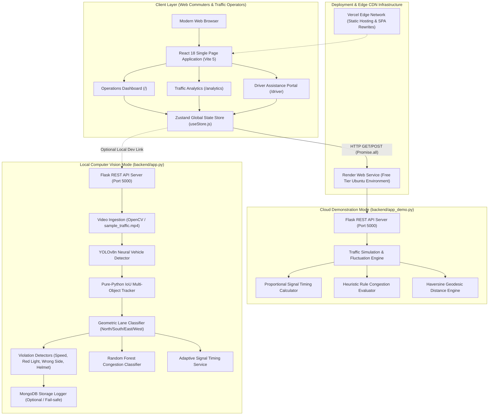
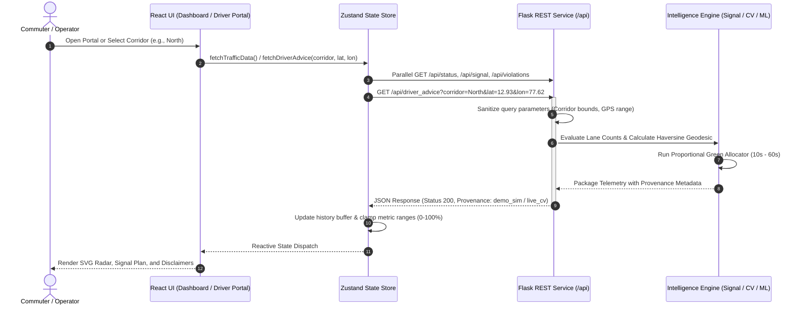
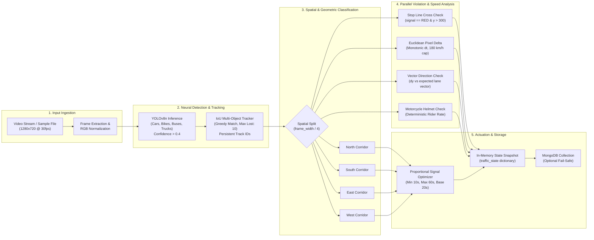

<div align="center">


<p align="center">
  <strong>Autonomous junction intelligence, computer-vision vehicle tracking, adaptive signal timing, and live commuter telemetry for urban bottlenecks.</strong>
</p>

<p align="center">
  <a href="https://bengaluru-traffic-ai.vercel.app/">
    
  </a>
  <a href="https://bengalurutrafficai.onrender.com/api/health">
    
  </a>
  <a href="https://github.com/Kaushtubha/BengaluruTrafficAI">
    
  </a>
</p>

<p align="center">
  
  
  
  
  
  
  
  
  
  
</p>

<p align="center">
  <a href="#-project-overview">Overview</a> •
  <a href="#-key-features">Key Features</a> •
  <a href="#-system-architecture">Architecture</a> •
  <a href="#-data-flow-architecture">Data Flow</a> •
  <a href="#-computer-vision-pipeline">CV Pipeline</a> •
  <a href="#-technology-stack">Tech Stack</a> •
  <a href="#-project-structure">Project Structure</a> •
  <a href="#-rest-api-specification">API Reference</a> •
  <a href="#-local-development--quickstart">Setup</a> •
  <a href="#-quality-assurance--testing">Testing</a> •
  <a href="#-telemetry-integrity--limitations">Limitations</a>
</p>

</div>

---

## 📌 Project Overview

Urban intersections frequently experience severe throughput collapse due to rigid, fixed-cycle signal controllers that cannot adapt to dynamic vehicular arrivals. In high-density corridors like **Silk Board, Bengaluru**, sudden queuing surges and delayed emergency vehicle transits amplify travel delays and fuel waste.

**BengaluruTrafficAI** is an end-to-end intelligent transportation system that integrates edge computer vision, proportional signal allocation, heuristic congestion modeling, and commuter-facing telemetry into a unified real-time dashboard.

```
┌────────────────────────────────────────────────────────────────────────────────────────┐
│                                   Dual-Mode Architecture                               │
├──────────────────────────────────────────────────┬─────────────────────────────────────┤
│  🖥️ Local Computer Vision Mode (backend/app.py)   │  ☁️ Cloud Demonstration Mode (app_demo)│
├──────────────────────────────────────────────────┼─────────────────────────────────────┤
│ • Full YOLOv8n inference on local sample video    │ • Lightweight simulation loop       │
│ • Pure-Python IoU multi-object vehicle tracking   │ • Micro-footprint (Render 512MB RAM)│
│ • Heuristic speed estimation & violation monitors │ • Synthetic traffic fluctuations    │
│ • Dynamic proportional green-time allocator       │ • Complete unified REST API schemas │
│ • Optional fail-safe MongoDB activity logging     │ • Zero GPU/C++ runtime overhead     │
└──────────────────────────────────────────────────┴─────────────────────────────────────┘
```

---

## ✨ Key Features

### 🚦 Operations Dashboard (`/`)
* **Real-Time Junction Radar**: Interactive SVG canvas displaying live vehicle distribution across North, South, East, and West approach lanes with animated transit pulses.
* **Proportional Signal Coordination**: Dynamic signal cycle optimizer calculating green times bounded between 10s and 60s based on relative queue weights.
* **Emergency Preemption Controls**: Interactive simulation trigger that preempts normal phase sequences and allocates maximum green clearance (60s) to emergency vehicles (ambulances, fire engines).
* **Live KPI Strip**: Instant visibility into active junction identity, heuristic congestion classification, all-time tracked count, and cycle duration.
* **Real-Time Violation Feed**: Streaming event log capturing red-light infractions, speeding incidents, wrong-side approaches, and helmet compliance checks.

### 📈 Traffic Analytics Engine (`/analytics`)
* **Historical Trend Charts**: Multi-snapshot stacked bar charts displaying cumulative violation trends over live intervals.
* **Violation Breakdown Analysis**: Recharts donut visualization tracking proportional distribution across all 4 infraction categories.
* **Lane Load Radar Distribution**: Directional radar visualization contrasting relative volume stress across all four corridors.
* **Lane Performance Summary Table**: Tabular metrics tracking vehicle counts, green durations, load percentages bounded to `0%..100%`, and dedicated `EMERGENCY` status badges.

### 🧭 Driver Assistance Portal (`/driver`)
* **Corridor-Specific Advisory**: Commuter selection across North (Hosur Rd), South (Electronic City Flyover), East (HSR Layout / Bellandur), and West (BTM Layout) corridors.
* **Signal Phase Telemetry**: Direct visibility into allocated green intervals, active phase recommendations, and queue status.
* **Straight-Line Proximity Telemetry**: Browser Geolocation integration with automated coordinate validation and Haversine geodesic distance calculation.
* **Reference Landmark Presets**: Approximate distance calculation from major transit nodes (Electronic City Toll, Koramangala Sony World, HSR Sector 1, BTM Water Tank).
* **Transparent Delay Disclosures**: Explicit labeling of queue delays as `ESTIMATE_UNAVAILABLE` due to camera field-of-view physical limitations.

---

## 🏛️ System Architecture

The following diagram illustrates the component architecture and the clear separation between the hosted demonstration environment and the local computer-vision execution mode:



---

## 🔄 Data Flow Architecture

The end-to-end request and telemetry synchronization flow operates with zero third-party tracking or paid API dependencies:



---

## 🎥 Computer Vision Pipeline

In local computer vision mode (`backend/app.py`), incoming video frames are processed through a sequential, modular perception pipeline:



---

## 🛠️ Technology Stack

### Frontend Architecture
| Package | Version | Architectural Responsibility |
|:---|:---:|:---|
| **React** | `18.3.1` | Declarative component hierarchy and virtual DOM rendering |
| **Vite** | `5.2.11` | Build tooling, Hot Module Replacement (HMR), and asset bundling |
| **Tailwind CSS** | `3.4.4` | Cyberpunk glassmorphic utility styling and responsive layout grid |
| **Framer Motion** | `11.2.10` | Hardware-accelerated UI transitions and micro-animations |
| **Recharts** | `2.12.7` | Time-series stream charts, stacked bar charts, and radar visualizations |
| **Zustand** | `4.5.2` | Centralized reactive state store and asynchronous polling coordinator |
| **Axios** | `1.7.2` | Promise-based HTTP client with timeout handling |
| **React Router** | `6.23.1` | Client-side routing across `/`, `/analytics`, and `/driver` |
| **Lucide React** | `0.395.0` | Accessible vector interface iconography |
| **React Hot Toast** | `2.4.1` | Contextual toast notification dispatches |

### Backend & Machine Learning
| Package | Version | Architectural Responsibility |
|:---|:---:|:---|
| **Python** | `3.8+` | Core server runtime and computation environment |
| **Flask** | `3.1.3` | Lightweight REST API routing and JSON serialization |
| **Flask-CORS** | `6.0.5` | Cross-Origin Resource Sharing policy enforcement |
| **Ultralytics (YOLOv8)** | `8.4.60` | Object detection engine for multi-class vehicular perception |
| **PyTorch / Torchvision** | `2.12.0 / 0.27.0` | Tensor computation and deep learning model runtime |
| **OpenCV Python** | `4.13.0` | Video capture, frame geometry transformations, and overlay rendering |
| **scikit-learn** | `1.9.0` | Random Forest classifier for congestion level estimation |
| **NumPy** | `2.4.6` | High-performance array operations and boundary calculations |
| **PyMongo** | `4.17.0` | MongoDB driver with graceful offline console fallback |
| **python-dotenv** | `1.2.2` | Safe environment variable resolution from `.env` |

---

## 📂 Project Structure

```
BengaluruTrafficAI/
├── .env.example                     # Environment template (coordinates, ports, db)
├── .gitignore                       # Multi-tier exclusion (venv, weights, logs, cache)
├── README.md                        # Master project documentation
├── render.yaml                      # Render Blueprint specification for demo deployment
├── requirements.txt                 # Full AI dependencies (PyTorch, YOLOv8, OpenCV)
├── requirements-demo.txt            # Minimal cloud dependencies (Flask, CORS, dotenv)
│
├── ai/                              # Computer vision & violation detection modules
│   ├── dataset/
│   │   └── sample_traffic.mp4       # Generic urban roadway demonstration footage
│   ├── db_logger.py                 # Fail-safe MongoDB logging with console fallback
│   ├── helmet_detector.py           # Motorcycle rider helmet compliance evaluator
│   ├── snapshot.py                  # Infraction image crop and disk capture
│   ├── speed_estimator.py           # Monotonic elapsed-time pixel displacement estimator
│   ├── violation_detector.py        # Stop-line red-light infraction detector
│   ├── wrong_side_detector.py       # Directional movement vector analyzer
│   └── yolo_detection.py            # Standalone YOLO inference demonstration script
│
├── backend/                         # Server application & algorithm services
│   ├── app.py                       # Local CV backend server (runs YOLO + OpenCV loop)
│   ├── app_demo.py                  # Hosted demonstration backend server (lightweight simulation)
│   ├── congestion_predictor.py      # Random Forest classifier with input sanitization
│   ├── lane_manager.py              # Frame width geometric lane divider
│   ├── signal_service.py            # Adaptive proportional green-time allocator
│   └── tracker_manager.py           # Pure-Python greedy IoU multi-object tracker
│
├── frontend/                        # React Single Page Application (SPA)
│   ├── package.json                 # Node dependencies and build scripts
│   ├── vercel.json                  # Vercel SPA route rewrite rules
│   ├── vite.config.js               # Vite bundling & React plugin configuration
│   ├── tailwind.config.js           # Theme colors, glow effects, and typography
│   └── src/
│       ├── main.jsx                 # Application entry point
│       ├── App.jsx                  # Root layout & route configuration
│       ├── store/
│       │   └── useStore.js          # Zustand store for parallel polling & advice state
│       ├── pages/
│       │   ├── Dashboard.jsx        # Operations Dashboard with SVG radar & live terminal
│       │   ├── Analytics.jsx        # Historical violation charts & lane performance
│       │   └── DriverPortal.jsx     # Commuter corridor assistance & GPS proximity
│       └── components/
│           ├── Layout.jsx           # Responsive shell with theme toggle & status pill
│           └── ParticleBackground.jsx # Cyberpunk ambient particle backdrop
│
└── tests/                           # Python automated regression test suite
    ├── __init__.py                  # Test package initialization
    ├── test_traffic_intelligence.py # Proportional signal, emergency, RF, and tracking tests
    └── test_driver_advice.py        # Demo API schema, coordinate validation, & live CV tests
```

---

## 📡 REST API Specification

Both backend servers (`backend/app.py` and `backend/app_demo.py`) implement unified REST contracts:

### 1. Service Health & Uptime
```http
GET /api/health
```
```json
{
  "status": "ok",
  "mode": "demo",
  "uptime_seconds": 3600
}
```

### 2. Live Traffic State Snapshot
```http
GET /api/status
```
```json
{
  "status": "online",
  "junction": "Silk Board, Bengaluru",
  "active_lane": "South",
  "congestion_level": "Medium",
  "congestion_provenance": "synthetic_demo_rule",
  "is_synthetic_congestion_model": true,
  "vehicle_counts": {
    "North": 12,
    "South": 18,
    "East": 9,
    "West": 4
  },
  "total_vehicles": 43,
  "tracked_vehicles": 1247,
  "violations": 14,
  "signal_plan": {
    "green_times": { "North": 28.3, "South": 37.5, "East": 22.1, "West": 12.1 },
    "priority_lane": "South",
    "cycle_time": 100.0,
    "emergency_override": false,
    "emergency_lane": null
  },
  "mode": "demo"
}
```

### 3. Adaptive Signal Plan
```http
GET /api/signal
```
```json
{
  "green_times": {
    "North": 28.3,
    "South": 37.5,
    "East": 22.1,
    "West": 12.1
  },
  "priority_lane": "South",
  "cycle_time": 100.0,
  "emergency_override": false,
  "emergency_lane": null
}
```

### 4. Violation Breakdown by Category
```http
GET /api/violations
```
```json
{
  "total_violations": 14,
  "red_light": 3,
  "wrong_side": 2,
  "speeding": 7,
  "no_helmet": 2
}
```

### 5. Simulate Emergency Priority Override
```http
POST /api/simulate_emergency
Content-Type: application/json

{ "lane": "North" }
```
```json
{
  "status": "success",
  "message": "Emergency vehicle simulated in North lane."
}
```
*(Sending `{ "lane": null }` or an unmonitored lane clears the active override).*

### 6. Driver Assistance & Corridor Advisory
```http
GET /api/driver_advice?corridor=North&lat=12.9352&lon=77.6245
```
* **Parameters**:
  * `corridor` *(optional, string)*: Approach corridor (`North`, `South`, `East`, `West`). Case-insensitive; defaults to active lane or `North`. Invalid input returns `400 Bad Request`.
  * `lat` *(optional, float)*: Commuter GPS latitude in degrees (-90.0 to 90.0).
  * `lon` *(optional, float)*: Commuter GPS longitude in degrees (-180.0 to 180.0).
```json
{
  "status": "success",
  "data_source": "demo_sim",
  "feed_description": "Render Free-Tier Simulation (Demonstration Data)",
  "junction": {
    "name": "Silk Board, Bengaluru",
    "latitude": 12.9176,
    "longitude": 77.6238,
    "is_configurable": true,
    "configuration_error": null
  },
  "approach": {
    "corridor": "North",
    "visible_vehicle_count": 12,
    "total_junction_vehicles": 43,
    "assigned_green_time_sec": 28.3,
    "cycle_time_sec": 100.0,
    "congestion_level": "Medium",
    "congestion_provenance": "synthetic_demo_rule"
  },
  "distance_telemetry": {
    "calculation_method": "Haversine Geodesic (Straight-Line)",
    "straight_line_distance_km": 1.96,
    "status": "CALCULATED",
    "disclaimer": "Straight-line aerial distance only. Actual road driving distance will be longer due to road topology and flyover ramps."
  },
  "delay_telemetry": {
    "delay_status": "ESTIMATE_UNAVAILABLE",
    "estimated_delay_mins": null,
    "reason": "Queue clearance delay cannot be accurately calculated without upstream queue length and continuous arrival rates outside camera FOV."
  },
  "safety_guidelines": [
    "Approaching North corridor. Maintain safe braking distance in stop-and-go queue.",
    "Merge early and avoid sudden lane switching near junction approach ramps."
  ],
  "corridor_status": {
    "monitored_corridors": ["North", "South", "East", "West"],
    "unmonitored_routes": "DATA_UNAVAILABLE"
  }
}
```

#### Quick Verification via cURL:
```bash
# Check service health
curl -s https://bengalurutrafficai.onrender.com/api/health

# Query commuter advice with coordinates
curl -s "https://bengalurutrafficai.onrender.com/api/driver_advice?corridor=North&lat=12.9352&lon=77.6245"
```

---

## ⚡ Local Development & Quickstart

### Prerequisites
* **Python**: `3.8+` (Tested on Python 3.10 and 3.12)
* **Node.js**: `18+` and **npm**: `9+`
* **MongoDB**: Optional (Service falls back gracefully to console logs if offline)

### 1. Repository Setup
```bash
git clone https://github.com/Kaushtubha/BengaluruTrafficAI.git
cd BengaluruTrafficAI
```

### 2. Environment Configuration
Copy the safe template into your local `.env`:
```bash
cp .env.example .env
```
*(The default configuration points to `http://localhost:5000` with optional Silk Board coordinates).*

### 3. Backend Setup

#### Option A: Lightweight Cloud-Identical Demo Mode (Fastest)
Ideal for testing UI synchronization, Recharts polling, and driver advice without downloading PyTorch weights:
```bash
python -m venv .venv

# Activate environment:
# Windows:
.venv\Scripts\activate
# macOS/Linux:
source .venv/bin/activate

# Install minimal server dependencies:
pip install -r requirements-demo.txt

# Start demo backend:
python backend/app_demo.py
```
*Server listening at `http://localhost:5000`*.

#### Option B: Full Computer Vision Perception Mode
Runs local YOLOv8 vehicle detection and tracking over `ai/dataset/sample_traffic.mp4`:
```bash
# In your activated virtual environment:
pip install -r requirements.txt

# Start full AI perception backend:
python backend/app.py
```

### 4. Frontend Setup
```bash
cd frontend

# Install client packages
npm install

# Launch Vite development server
npm run dev
```
*Application available at `http://localhost:5173`*.

---

## 🧪 Quality Assurance & Testing

The repository contains an automated regression test suite using Python's standard library `unittest` module (zero external test runner dependencies):

```bash
# Run all 46 unit and integration tests across both suites
python -m unittest discover tests -v
```

### Verified Test Suites:
1. **`tests.test_traffic_intelligence` (25 Tests)**:
   * `TestSignalService`: Proportional green allocation bounds, zero-vehicle base allocation fallback, negative value clamping, and emergency lane priority override mechanics.
   * `TestCongestionPredictor`: Boundary transition points (`Low` < 15, `Medium` 15-34, `High` >= 35), NaN/Inf coordinate rejection, and synthetic model metadata verification.
   * `TestSpeedEstimator`: Monotonic timestamp interval validation, negative interval handling, tracking age resets (>3s), and plausible speed caps (180 km/h).
   * `TestViolationDeduplication`: Track-ID deduplication across Red Light, Speeding, Wrong Side, and Helmet violation detectors.
2. **`tests.test_driver_advice` (21 Tests)**:
   * `TestDriverAdviceDemo`: Query parameter sanitization, corridor length limits (32 chars), case-insensitive matching, Haversine geodesic calculations, and delay transparency disclaimers.
   * `TestDriverAdviceLiveCV`: Local computer vision mode endpoint schemas and data source verification.
   * `TestJunctionEnvironmentConfig`: Environmental override coordinate boundary checking (-90..90, -180..180).

*Current Suite Status: **46 passed, 0 failed, 0 errors** in 18.9s*.

---

## 🚀 Deployment Infrastructure

| Component | Platform | Configuration & Build Parameters | Live Public URL |
|:---|:---:|:---|:---|
| **Frontend** | **Vercel** | `buildCommand`: `npm install && npm run build`<br/>`outputDirectory`: `dist`<br/>`framework`: `vite`<br/>SPA URL Rewrites: `/(.*) -> /index.html` | [bengaluru-traffic-ai.vercel.app](https://bengaluru-traffic-ai.vercel.app/) |
| **Backend API** | **Render** | `buildCommand`: `pip install -r requirements-demo.txt`<br/>`startCommand`: `python backend/app_demo.py`<br/>Environment: Python 3 Web Service | [bengalurutrafficai.onrender.com](https://bengalurutrafficai.onrender.com/api/health) |

> ℹ️ **Cold Start Notice**: Render's free tier automatically suspends web services after 15 minutes of inactivity. Initial requests after a period of dormancy may experience a 30–50 second spin-up latency. Subsequent API polls execute normally.

---

## ⚠️ Telemetry Integrity & Limitations

To maintain strict scientific and technical honesty, the following constraints and architectural boundaries are explicitly disclosed:

1. **Uncalibrated Speed Estimation**: In local computer vision mode (`ai/speed_estimator.py`), vehicle speed is calculated from pixel displacement over monotonic time using a fixed heuristic scale (`0.05 m/px`). Because camera intrinsic matrix calibration, perspective homography rectification, and surveyed ground markers are not present, speed outputs represent relative motion estimations rather than calibrated radar speeds.
2. **Synthetic Congestion Classification**: The scikit-learn Random Forest classifier (`backend/congestion_predictor.py`) is trained on a synthetic feature matrix designed to demonstrate machine learning inference in a web dashboard. It is an exploratory heuristic model and does not represent an empirically calibrated model trained on physical inductive loop detectors.
3. **Geodesic vs. Road Distance**: Commuter proximity calculated by the Driver Assistance Portal uses the Haversine spherical formula. This represents straight-line aerial distance; actual road driving distance will be longer due to road topology and flyover ramps.
4. **Camera Field-of-View Limitations**: Because optical cameras cannot monitor vehicular queues beyond their physical line of sight, queue clearance delay is transparently reported as `ESTIMATE_UNAVAILABLE` rather than extrapolating speculative queue delays.
5. **Demonstration Video Footage**: The video stream processed by local computer vision mode is generic urban roadway sample footage and does not represent a live CCTV feed from the physical Silk Board intersection.

---

## 🗺️ Future Roadmap

- [ ] **Camera Matrix Homography**: Implementation of 4-point perspective transform calibration for physically accurate metric speed estimation.
- [ ] **Empirical Congestion Models**: Training predictive time-series models (e.g., XGBoost, LSTM) on historical municipal open data.
- [ ] **RTSP Camera Ingestion**: Direct support for live municipal CCTV RTSP video streams.
- [ ] **OpenStreetMap Road Routing**: Integration of open-source routing (OSRM) for genuine driving distance and turn-by-turn navigation.
- [ ] **Multi-Junction Coordination**: Networked green-wave signal coordination across adjacent arterial intersections.

---

## 📄 License & Attribution

Distributed under the **MIT License**. See [`LICENSE`](LICENSE) for complete terms.

**Developed by Kaushtubha** — Built for urban mobility intelligence and scalable traffic optimization.
*Live Demo: [bengaluru-traffic-ai.vercel.app](https://bengaluru-traffic-ai.vercel.app/)* • *API Health: [bengalurutrafficai.onrender.com/api/health](https://bengalurutrafficai.onrender.com/api/health)*
